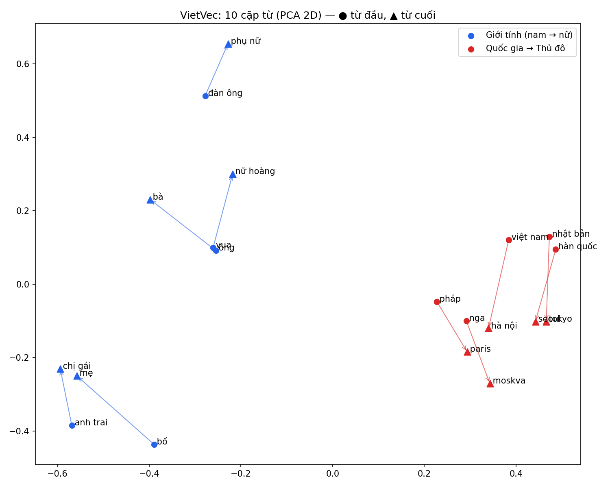
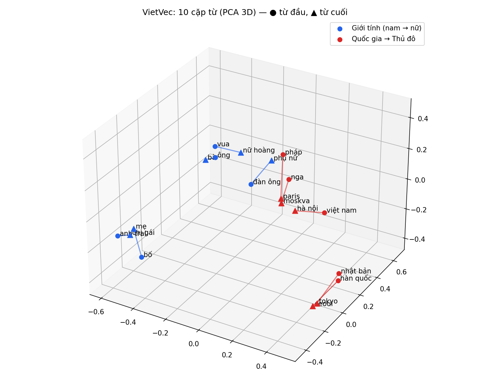

# 🇻🇳 VietVec: Vietnamese Word2Vec from Scratch

Xây dựng mô hình biểu diễn ngữ nghĩa từ (Word Embedding - Word2Vec) từ đầu (from scratch) dành riêng cho tiếng Việt, triển khai kiến trúc Skip-gram kết hợp Negative Sampling (SGNS) trên PyTorch.

---

## 📌 Tính năng chính

- **Tiền xử lý đặc thù tiếng Việt**: Hỗ trợ chuẩn hóa Unicode, loại bỏ ký tự rác và tách từ (Word Segmentation) với `underthesea`.
- **Kiến trúc Skip-gram**: Tự cài đặt hai ma trận trọng số $W_{in}$ (center embeddings) và $W_{out}$ (context embeddings).
- **Negative Sampling Loss**: Tự cài đặt hàm mục tiêu binary cross-entropy và bộ lấy mẫu phân phối Unigram mũ $0.75$ ($U(w)^{3/4}$).
- **Subsampling kỹ thuật Mikolov**: Giảm thiểu ảnh hưởng của các hư từ/từ xuất hiện quá nhiều.
- **Đánh giá & Trực quan hóa**:
  - Tìm kiếm từ đồng nghĩa (Cosine Similarity).
  - Phép loại suy từ vựng (Word Analogy: $A - B + C = D$).
  - Trực quan hóa 10 cặp từ trong không gian 2D / 3D bằng PCA.
  - Xuất định dạng vector chuẩn `.vec`.

---

## 📂 Cấu trúc dự án

```text
vietvec/
├── data/processed/          # vocab.json, wiki_vi_tokenized.txt, corpus_ids.npz
├── models/                  # vietvec.pt (embeddings), vietvec.vec (định dạng Gensim)
├── results/                 # Hình trực quan hoá 10 cặp từ (2D / 3D)
├── vietvec/                 # Core module
│   ├── data_reader.py       # Đọc parquet Wikipedia theo luồng, tách câu
│   ├── preprocessing.py     # Tách từ underthesea, Vocabulary + subsampling
│   ├── dataset.py           # Mã hoá corpus, sinh cặp Skip-gram vector hoá trên GPU, Negative Sampler
│   ├── model.py             # SkipGramModel (W_in, W_out, loss SGNS)
│   ├── trainer.py           # Vòng lặp train: SparseAdam + LR giảm tuyến tính
│   └── evaluate.py          # Embeddings: từ gần nghĩa, loại suy, xuất .vec
├── scripts/
│   ├── download_wiki.py                 # Tải Wikipedia tiếng Việt (parquet)
│   ├── preprocess_all_multiprocess.py   # Tách từ toàn bộ corpus + dựng vocab
│   ├── clean_and_filter_vocab.py        # Lọc vocab: min_count>=20, bỏ ký tự ngoài tiếng Việt
│   ├── encode_corpus.py                 # Text -> corpus_ids.npz (ID từ + độ dài câu)
│   ├── evaluate_model.py                # Đánh giá định tính + độ chính xác loại suy
│   └── visualize_pairs.py               # PCA 2D/3D cho 10 cặp từ
├── kaggle/                  # Kernel train trên GPU Kaggle
├── train.py                 # Script train chính
└── requirements.txt
```

---

## 🚀 Sử dụng

```bash
pip install -r requirements.txt

# 1. Dữ liệu (đã có sẵn vocab.json + wiki_vi_tokenized.txt thì bỏ qua 2 bước đầu)
python scripts/download_wiki.py
python scripts/preprocess_all_multiprocess.py
python scripts/clean_and_filter_vocab.py
python scripts/encode_corpus.py

# 2. Train (GPU khuyến nghị; thử nhanh: --max_tokens 3000000 --epochs 1 --dim 100)
python train.py

# 3. Đánh giá, xuất .vec và trực quan hoá
python scripts/evaluate_model.py --export models/vietvec.vec
python scripts/visualize_pairs.py
```

Dùng mô hình đã train:

```python
from vietvec.evaluate import Embeddings
emb = Embeddings("models/vietvec.pt")
emb.most_similar("hà_nội")
emb.analogy("ông", "bà", "vua")   # ông : bà = vua : ?
```

### Train trên Kaggle

Upload `corpus_ids.npz` + `vocab.json` thành dataset `vietvec-data`, thư mục code (`train.py`, `vietvec/`) thành dataset `vietvec-code`, rồi:

```bash
kaggle kernels push -p kaggle --accelerator NvidiaTeslaT4
kaggle kernels output <user>/vietvec-train -p models
```

---

## ⚙️ Cấu hình mặc định

| Tham số | Giá trị |
|---|---|
| Kiến trúc | Skip-gram + Negative Sampling |
| Số chiều | 300 |
| Cửa sổ | ngẫu nhiên 1..5 |
| Mẫu âm | 5 (unigram^0.75) |
| Subsampling | t = 1e-4 |
| Optimizer | SparseAdam, lr 2e-3 giảm tuyến tính |
| Batch | 32.768 cặp |
| Epoch | 5 |
| Vocab | 160.644 từ (min_count ≥ 20) |
| Corpus | Wikipedia tiếng Việt 2023-11: 11,9 triệu câu, 168,8 triệu token |

---

## 📊 Kết quả (5 epoch, Kaggle T4, ~34 phút)

Loss SGNS hội tụ quanh **~1,8** (K = 5 mẫu âm). Mô hình: `models/vietvec.pt` (160.644 × 300), `models/vietvec.vec`.

**Từ gần nghĩa nhất (cosine):**

| Từ | Láng giềng |
|---|---|
| máy_tính | phần_cứng, máy_vi_tính, phần_mềm, máy_tính_xách_tay, máy_chủ, mainframe |
| sông | thượng_nguồn, hạ_lưu, chi_lưu, cửa_sông, phụ_lưu, lưu_vực |
| bác_sĩ | nha_sĩ, thầy_thuốc, dược_sĩ, nhi_khoa, y_tá |
| đẹp | đẹp_đẽ, khả_ái, duyên_dáng, thanh_lịch, thơ_mộng |
| vua | nhà_vua, quốc_vương, trị_vì, hoàng_đế, lên_ngôi |

**Phép loại suy:** `việt_nam : hà_nội = nhật_bản : tokyo` (top-1); `ông : bà = vua : vương_hậu / hoàng_hậu` (top-3)

| Quan hệ | Độ chính xác | Số câu hỏi |
|---|---|---|
| quốc gia → thủ đô | 59,0% | 156 |
| nam → nữ | 58,2% | 110 |
| quốc gia → ngôn ngữ | 50,0% | 30 |

**Trực quan hoá 10 cặp từ (PCA):** hai nhóm quan hệ tách biệt rõ; các vector quốc gia → thủ đô gần như song song.

| 2D | 3D |
|---|---|
|  |  |

---

## 📅 Lộ trình

- [x] Khởi tạo dự án & cấu trúc thư mục
- [x] Giai đoạn 1: Tiền xử lý dữ liệu tiếng Việt & xây dựng Vocabulary
- [x] Giai đoạn 2: Data pipeline & Negative Sampler
- [x] Giai đoạn 3: Kiến trúc mô hình & hàm loss
- [x] Giai đoạn 4: Huấn luyện trên GPU (Kaggle T4)
- [x] Giai đoạn 5: Đánh giá & trực quan hoá

---

## 📄 Bản quyền
Dự án được phân phối dưới giấy phép MIT.
